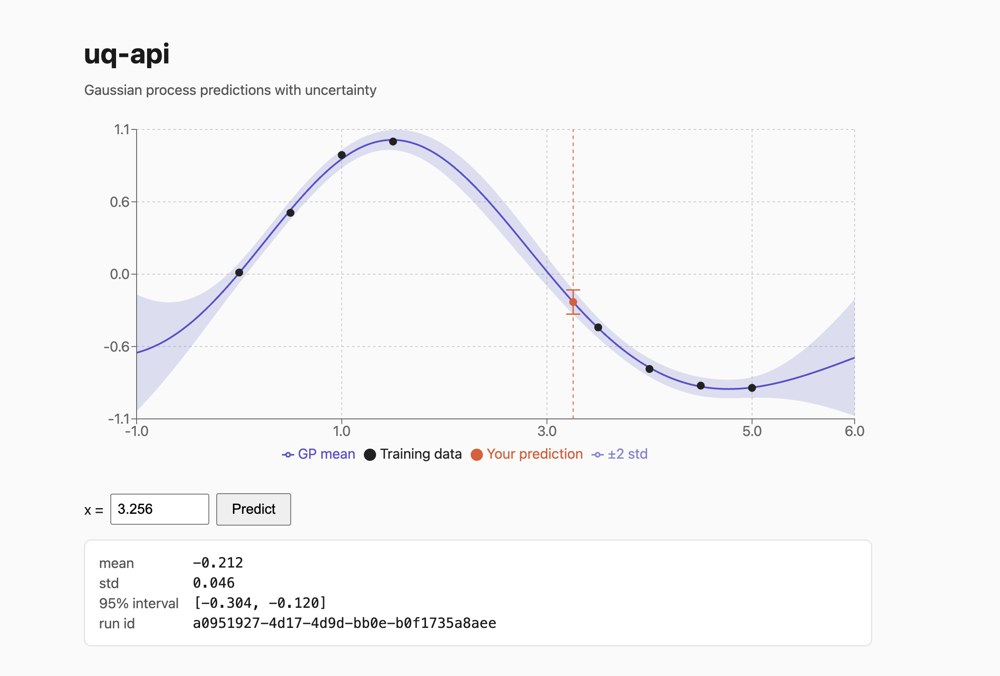
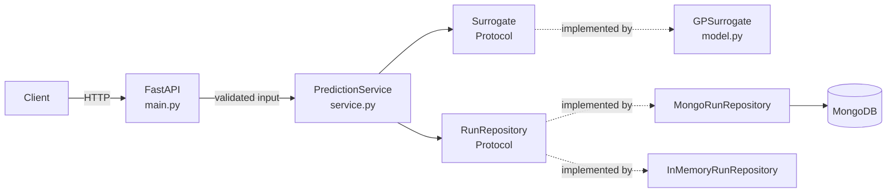

# uq-api


A containerised REST API that returns predictions **with uncertainty**, using a Gaussian process surrogate model.



Every prediction comes back as a mean and a standard deviation, and every run is stored in MongoDB so it can be retrieved later.

```json
POST /predict  {"x": [[0.5], [2.5], [6.0]]}

{
  "run_id": "f0336424-...",
  "mean": [0.488, 0.493, -0.635],
  "std":  [0.036, 0.066, 0.222]
}
```

The standard deviation grows as inputs move away from the training data. At `x = 6.0`, beyond the data, the prediction is least accurate, and the model reports that by returning its largest uncertainty.

---

## Why uncertainty?

Surrogate models stand in for expensive simulations. A fast approximation is only useful if you know where to trust it. A Gaussian process gives you both: a prediction, and a measure of how far that prediction is from anything the model has seen.

---

## Architecture



| Layer | File | Responsibility |
|---|---|---|
| HTTP | `main.py` | Routing, Pydantic validation, status codes |
| Service | `service.py` | Calls the model, records the run |
| Model | `model.py` | Gaussian process (scikit-learn, RBF + white noise kernel) |
| Storage | `repository.py` | Saves and retrieves runs (MongoDB or in-memory) |

### Design decisions

- **Dependency inversion.** `PredictionService` depends on two `Protocol` interfaces, `Surrogate` and `RunRepository`, never on concrete classes. Swapping scikit-learn for GPyTorch, or MongoDB for another store, needs no change to the service.
- **Repository pattern.** Storage sits behind `save` and `get`. Production uses MongoDB; tests and quick local runs use an in-memory store.
- **Configuration from the environment.** If `MONGO_URL` is set, runs go to MongoDB. If not, they stay in memory.
- **Train once at startup.** The model is fitted in FastAPI's `lifespan` handler, not per request. The database connection is opened and closed there too.
- **Validation at the boundary.** Pydantic rejects malformed input with a `422` before any application code runs.

---

## Quickstart

Requires [Docker](https://www.docker.com/).

```bash
docker compose up --build
```

This starts three containers: the React UI, the API and MongoDB.

- **http://localhost:5173**: the UI (chart, uncertainty band, predict box)
- **http://localhost:8000/docs**: interactive API documentation

| Method | Endpoint | Description |
|---|---|---|
| `GET` | `/health` | Liveness check |
| `POST` | `/predict` | Predict mean and std for one or more inputs |
| `GET` | `/runs/{run_id}` | Retrieve a stored run (`404` if not found) |
| `GET` | `/curve` | Mean and std over a grid of x values, plus the training data (used by the UI; does not store runs) |

Example with curl:

```bash
curl -X POST http://localhost:8000/predict \
  -H "Content-Type: application/json" \
  -d '{"x": [[0.5], [2.5]]}'
```

Stop with `docker compose down`. Add `-v` to delete stored runs as well.

---

## Local development

Requires [uv](https://docs.astral.sh/uv/).

```bash
uv sync
uv run uvicorn uq_api.main:app --reload
```

Without `MONGO_URL`, the app uses the in-memory repository, so no database is needed.

---

## Testing

The suite follows the testing pyramid. Each level isolates a different layer.

```
        E2E          7   full HTTP round trips via TestClient
     Integration     2   MongoRunRepository against a real database
      Component      4   PredictionService with fake model and repository
        Unit         6   GPSurrogate on its own, including a calibration check

  + Performance      3   latency and training-time budgets (pytest -m perf)
  + Load                 Locust, against the full Docker stack
```

| File | Level | What it checks |
|---|---|---|
| `test_model.py` | Unit | Output shapes, non-negative std, **std grows away from data**, fit to training points |
| `test_calibration.py` | Unit | At x = 6.0, beyond the training data, the prediction is off by more than 0.3 but the true value still falls inside ±2 std |
| `test_service.py` | Component | Service passes model output through, saves every run, returns the repository's ID, `preview` saves nothing |
| `test_mongo_repository.py` | Integration | Save/get round trip and missing IDs against real MongoDB |
| `test_api.py` | End-to-end | Health check, prediction, storage round trip, `/curve`, `400`/`404`/`422` handling |
| `test_performance.py` | Performance | p95 request latency, batch prediction time, GP training time |

Component tests use fakes that satisfy the `Protocol` interfaces, so a failure points to the service itself rather than to scikit-learn or the database.

**Run without a database** (the MongoDB tests are skipped):

```bash
uv run pytest -v
```

**Run everything, including MongoDB:**

```bash
docker compose up -d mongo
MONGO_URL=mongodb://localhost:27017 uv run pytest -v
```

---

## Performance

Measured on a MacBook Air (Apple silicon), with the API, MongoDB and the load generator all running on the same machine. Treat these as indicative, not production figures.

### Performance tests (pytest, `-m perf`)

In-process via `TestClient`, no database: this measures the code and model, not the network.

| Test | Result |
|---|---|
| Single-point prediction | ~0.8 ms per request |
| Predict 1,000 points in one call | < 5 ms |
| Fit the GP on 500 points | 0.12 s |

### Load tests (Locust, full Docker stack with MongoDB)

Simulated users pick a random endpoint (5:1:1 weighting of `/predict`, `/curve`, `/health`) and pause 0.1–0.5 s between actions.

| Users | Requests | Failures | Throughput | p50 | p95 | p99 |
|---|---|---|---|---|---|---|
| 50 | 4,578 | 0 | ~164 req/s | 6 ms | 22 ms | 55 ms |
| 300 | 33,273 | 0 | ~600 req/s (plateau) | 200 ms | 440 ms | 610 ms |

**Reading the results:**

- At 50 users the API is not the bottleneck. 50 users each waiting ~0.3 s between requests can only generate ~165 req/s, which is exactly where throughput levelled off.
- At 300 users the API saturates. Demand was roughly 1,000 req/s, but throughput plateaued at ~600 req/s while median latency rose from 6 ms to 200 ms.
- `/health`, which does no work, slowed down just as much as `/predict`. The extra latency is requests queueing for a single Uvicorn worker, not the cost of the GP.
- No request failed at either load.

**Next steps to raise capacity:** run multiple Uvicorn workers, scale the API horizontally behind a load balancer, and move the load generator to a separate machine for cleaner measurements.

Run the load test yourself:

```bash
docker compose up --build
uv run locust -f locustfile.py --host http://localhost:8000 --headless -u 50 -r 10 -t 30s
```

---

## Project structure

```
uq-api/
├── src/uq_api/
│   ├── main.py          FastAPI app, endpoints, startup
│   ├── service.py       PredictionService
│   ├── model.py         Surrogate protocol, GPSurrogate
│   └── repository.py    RunRepository protocol, Mongo and in-memory stores
├── tests/
│   ├── conftest.py
│   ├── test_model.py
│   ├── test_service.py
│   ├── test_mongo_repository.py
│   ├── test_api.py
│   ├── test_calibration.py
│   └── test_performance.py
├── ui/                  React + TypeScript frontend (Vite, Recharts)
├── docs/                screenshot
├── .github/workflows/   CI: lint, tests, Docker build
├── locustfile.py        load test
├── Dockerfile
├── compose.yaml
└── pyproject.toml
```

---

## Limitations and next steps

- **Toy training data.** The model is trained at startup on noisy samples of `sin(x)`. A real deployment would load data or a trained model from storage.
- **Scaling.** Exact GP training costs O(n³) in the number of data points. Beyond a few thousand points, a sparse or approximate GP would be needed.
- **Planned:** multiple Uvicorn workers, and an endpoint to retrain the model on new data.

---

## Tech stack

Python 3.13 · FastAPI · Pydantic · scikit-learn · NumPy · MongoDB (PyMongo) · React · TypeScript · Vite · Recharts · pytest · Locust · ruff · Docker · Docker Compose · GitHub Actions · uv
